# sayidwithenglish

Türkçe konuşan kullanıcılar için kişisel İngilizce öğrenme çalışma alanı. Sekiz dolu ekran ve etkileşimli mock vocabulary akışları korunur. Phase 2 ile gerçek Supabase email/password authentication ve kalıcı kullanıcı profili eklenmiştir. [Master PRD](docs/01_MASTER_PRD.md) hedef ürünü; bu README çalışan uygulamanın sınırlarını anlatır.

## Kurulum ve çalıştırma

Node.js 20.9 veya üzeri ve npm gerekir. Inter Latin ve Latin-ext font dosyaları npm paketiyle yerel olarak gelir; `next/font/local` kullanılır. `.env.example` içindeki Supabase URL, public key ve `APP_URL` gereklidir. Bu checkout için `.env.local` connector üzerinden hazırlanmıştır. Auth URL/email ayarları ve yeni ortam kurulumu [Phase 2 kurulumunda](docs/04_AUTH_SETUP.md) açıklanır.

```sh
npm ci
npm run dev
```

[localhost:3000](http://localhost:3000) üzerinde açın. Oturumu olmayan kullanıcı `/login` sayfasına yönlendirilir; giriş sonrası `/dashboard` açılır.

| Komut | İşlev |
| --- | --- |
| `npm run dev` | Geliştirme sunucusu |
| `npm run build` | Üretim derlemesi |
| `npm run start` | Önceden derlenmiş uygulamayı başlatır |
| `npm run lint` | ESLint kontrolü |
| `npm run typecheck` | Next.js route türlerini üretir ve TypeScript kontrolünü çalıştırır |
| `npm run test:e2e` | Playwright ile shell ve prototip akışlarını doğrular |

Playwright makinede kurulu Google Chrome'u kullanır. `npm run test:e2e` izole `.next-auth-e2e` üretim build'ini, loopback Auth/PostgREST fixture'ını ve `127.0.0.1:3100` test sunucusunu kendisi başlatır; canlı Supabase projesine test hesabı yazmaz. Test ekranları 1440×900, 768×1024, 390×844 ve 320×720 boyutlarındadır. Mevcut navigasyon, responsive shell, kütüphane, mock işleme, review, tutor ve alıştırma testlerine auth, session refresh, reset callback, logout ve kalıcı profil testleri eklenmiştir. Production uygulamada auth bypass yoktur.

Phase 2 doğrulamasında lint, TypeScript ve gerçek proje environment'ı ile üretim derlemesi başarılıdır. Playwright sonucu 109 başarılı, 7 ilgili viewport'a uygulanmadığı için atlanan testtir (116 test, 0 başarısız). Sonuçlar ve güncel 71 capture [Phase 2 QA raporunda](qa/PHASE2_QA_REPORT.md) kayıtlıdır. [Önceki QA raporu](qa/QA_REPORT.md) Phase 1'in tarihsel kaydıdır.

## Ekran görüntüleri

Masaüstü (1440×900) ve mobil (390×844) görünümler. Aşağıdaki seçki Phase 1 prototipini gösterir; Phase 2 auth/profil ekranları güncel QA matrisindedir.

| Dashboard | Ekle (AI işlemiş) |
| --- | --- |
| 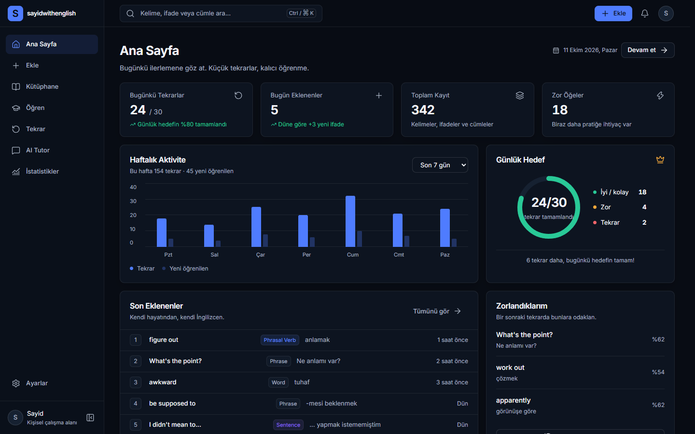 | 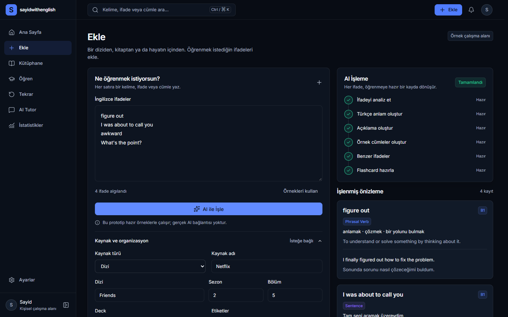 |

| Kütüphane | Kayıt detayı (drawer) |
| --- | --- |
| 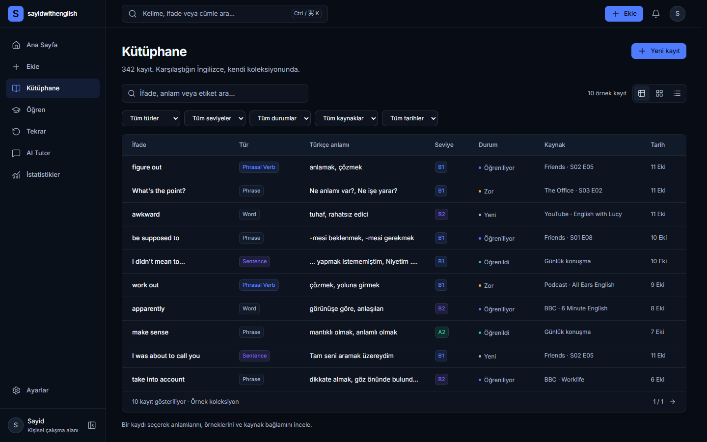 | 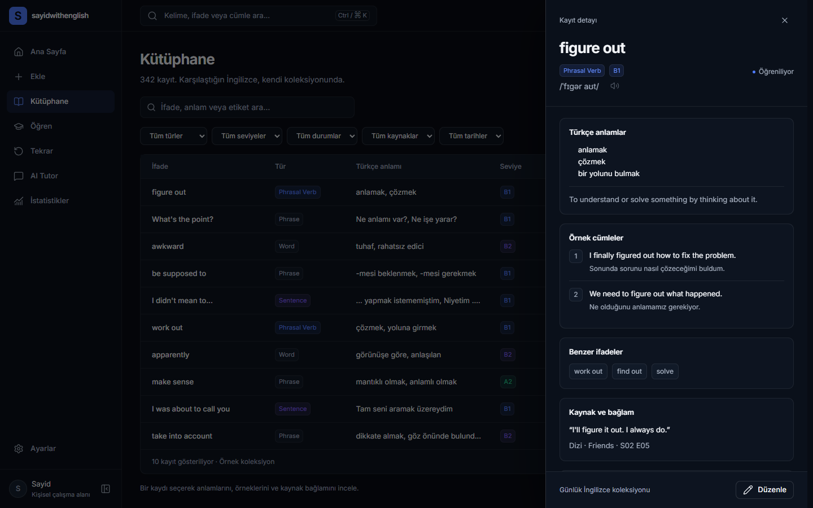 |

| Öğren | Tekrar (kart arka yüzü) |
| --- | --- |
| 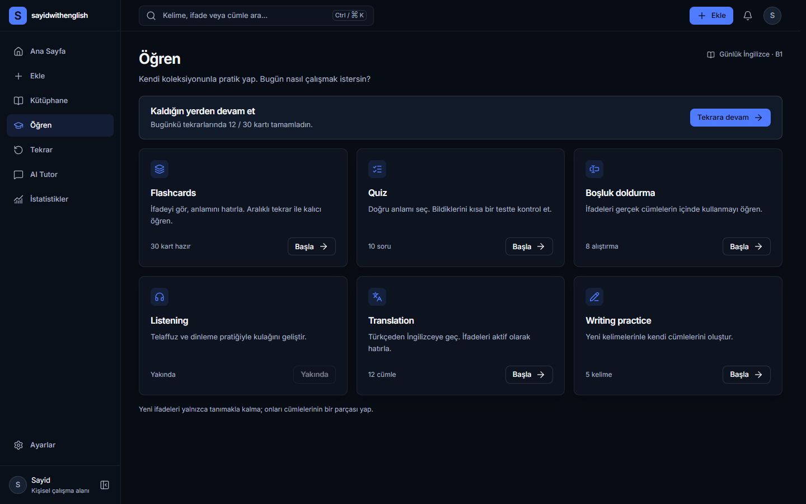 | 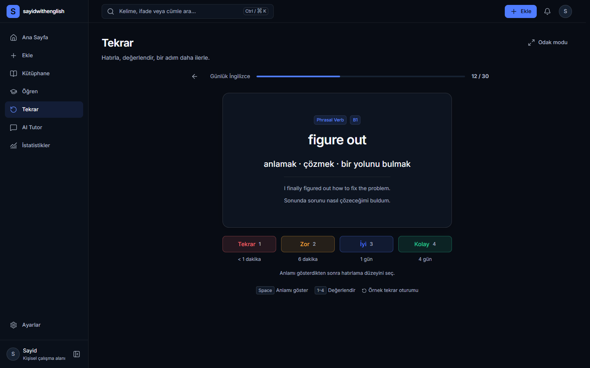 |

| Tutor (düzeltme) | İstatistikler |
| --- | --- |
| 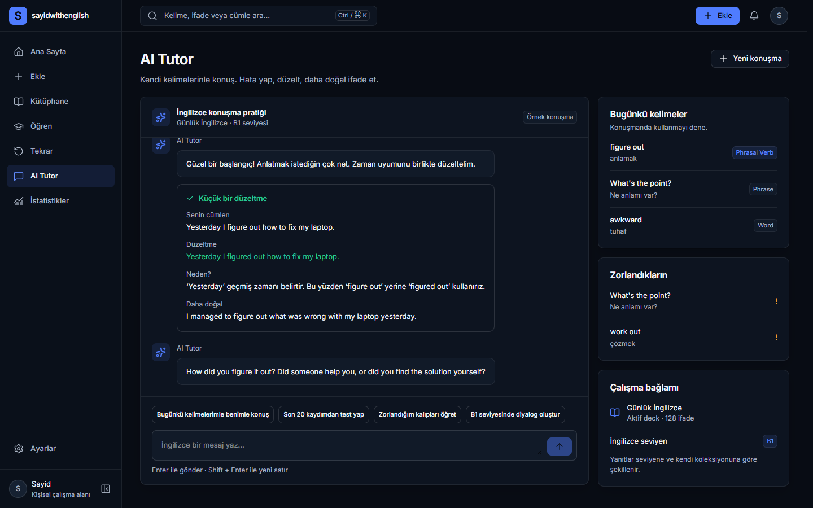 | 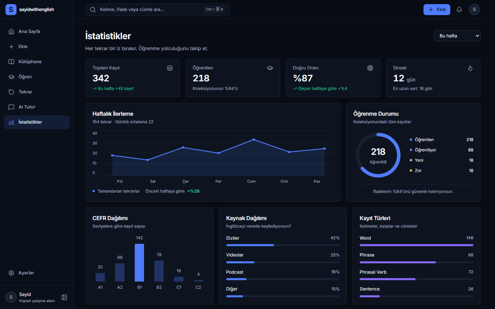 |

| Ayarlar | Mobil: dashboard / kütüphane |
| --- | --- |
| 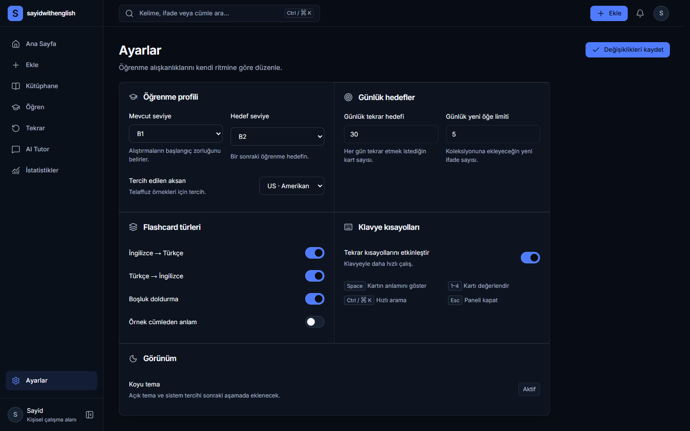 | 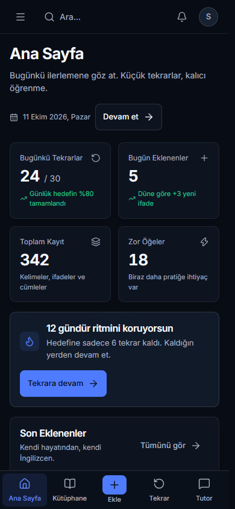 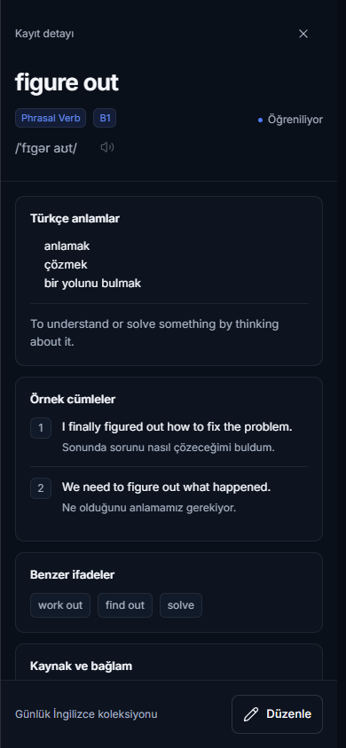 |

## Mevcut ekranlar

| Yol | Uygulanan içerik ve davranış |
| --- | --- |
| `/dashboard` | Dört KPI, haftalık aktivite/dönem seçimi, günlük hedef halkası, son eklenenler, zorlanılan ifadeler, tekrar CTA ve aktivite heatmap'i; kayıtlardan detay açılır |
| `/add` | Satır bazlı giriş ve canlı sayaç, kaynak/deck/etiket metadata'sı, altı aşamalı mock işleme, hazır sonuç önizlemeleri ve oturum içi kütüphaneye kaydetme |
| `/library` | İfade/anlam/etiket araması; tür, CEFR, durum, kaynak ve tarih filtreleri; tablo/kart/liste görünümleri; kayıt detayında ifade ve kişisel not düzenleme |
| `/learn` | Altı öğrenme modu kartı; flashcards tekrar ekranına gider; quiz, boşluk doldurma, translation ve writing için birer yerel örnek alıştırma; listening devre dışıdır |
| `/review` | İlerleme, flashcard ön/arka yüz, dört değerlendirme, oturum tamamlama/yeniden başlatma ve kabuğu gizleyen odak modu |
| `/tutor` | Hazır konuşma, düzeltme kartı, bağlam paneli, dört prompt ve metin girişine yerel hazır yanıt; yeni konuşma başlangıç örneğine döner |
| `/statistics` | Dört KPI, haftalık aktivite, öğrenilenler, CEFR/kaynak/tür dağılımları, zor kategoriler ve heatmap |
| `/settings` | Profil adı/avatar URL, seviye, hedef, günlük limit ve aksanı Supabase'e kaydetme; kart türleri/kısayollar oturum içi; çıkış yapma |
| `/login`, `/register` | Email/password giriş, kayıt, validation ve email doğrulama bildirimi |
| `/forgot-password`, `/reset-password` | Supabase recovery email isteği ve doğrulanmış oturumla şifre değişimi |
| `/auth/callback` | PKCE veya token-hash email doğrulama/recovery callback'i |

Masaüstünde sidebar 216px'tir ve 64px'e daraltılabilir. Tablet genişliklerinde (640–1023px) sidebar sabit 64px olur. Mobilde (<640px) beş öğeli alt navigasyon ve tüm sekiz sayfayı açan üst menü bulunur. Topbar 56px yüksekliğindedir. Dar ekranlarda KPI'lar iki kolon, kütüphane kayıtları kart, detay paneli ekran genişliğinde, işleme ve tutor panelleri tek kolon olur.

Arama düğmesi veya `Ctrl/Cmd + K`, yalnız sayfa adlarını filtreleyen hızlı erişim penceresini açar. Ok tuşları, Enter ve Escape desteklenir. Kayıt araması `/library` içinde yapılır. Bildirim menüsü boş durum gösterir; profil bağlantısı Ayarlar'a gider. Shell görünen adını gerçek profilden alır. Tekrar ekranında `Space` anlamı açar, `1–4` açılmış kartı değerlendirir; form/bağlantı/düğme odağında ve açık dialog'da bu genel tekrar kısayolları devreye girmez. `N` ve `/` ürün kısayolları uygulanmamıştır.

## Mock veri ve uygulama sınırları

`lib/mock-data.ts` on ayrıntılı örnek kayıt ve 342 kayıtlık örnek toplamla birlikte grafik, dağılım, konuşma ve alıştırma fixture'larını merkezi olarak tutar. 342 gerçek veya yüklenmiş satır değildir; filtreler on örnek ve bu oturumda eklenen kayıtlar üzerinde çalışır. Toplam/eklenen KPI'ları yeni kayıtlara göre artar. Grafikler, doğruluk, seri, öğrenilen ve zor kayıt toplamları gerçek kullanıcı olaylarından hesaplanmaz; örnek fixture'lardır. Dashboard'un 24 tekrar değeri ile review oturumunun 12'den başlayan ilerlemesi ayrı örneklerdir.

`PrototypeProvider` eklenen kayıtları, ifade/not değişikliklerini, kart türlerini, kısayolları, tekrar sayacını ve odak modunu React belleğinde tutar. Bunlar sayfa geçişlerinde korunur; tam yeniden yükleme örnek başlangıcı geri getirir. Profil öğrenme tercihleri ise Supabase'den yüklenir ve kalıcıdır. Form taslakları, filtreler, tutor konuşması ve alıştırma yanıtları ekranın yerel durumudur.

Ekle akışı yalnız hazır kayıtlarla eşleşen ifadeleri zenginleştirir. Desteklenmeyen giriş için hazır örnek bulunamadığını bildirir; tamamen desteklenmeyen girişte sonuç sayısı sıfırdır ve kaydetme aksiyonu gösterilmez. Gerçek AI çağrısı yapılmaz. Tutor yanıtları ve düzeltmesi hazır metinlerdir; writing otomatik dil değerlendirmesi yapmaz. Mod kartlarındaki soru/kart sayıları örnek UI içeriğidir; quiz, cloze, translation ve writing tam bir çok sorulu öğrenme motoru değildir.

Tekrar değerlendirmesi sayacı ilerletir ve sonraki örnek kartı açar. Gösterilen aralıklar örnek metindir; gerçek SRS zamanlaması, due queue veya kalıcı review geçmişi yoktur. Ayarlar seviye bağlamına, hedeflere ve tekrar kısayollarına yansır; aksan, kart türleri ve yeni öğe limiti kaydedilebilir tercihlerdir, henüz ses üretimini veya öğrenme motorunu yönetmez.

Supabase Auth ve yalnız `profiles` tablosu gerçektir. Sekiz uygulama route'u korumalıdır; session cookie'lerle korunur ve yenilenir. Vocabulary/review veritabanı, Storage, bulut vocabulary senkronizasyonu ve gerçek AI/TTS entegrasyonu yoktur. Telaffuz ses düğmeleri ve listening devre dışıdır. Yalnız koyu tema uygulanmıştır. Deck/tag yönetimi, silme/export, PWA/offline, kalıcı vocabulary saklama ve açık/sistem teması sonraki kapsamdır.

## Mimari

Next.js App Router, TypeScript, React, Tailwind CSS 4, CSS Modules, Lucide ve Radix UI korunur. Auth için yalnız `@supabase/ssr` ve `@supabase/supabase-js` eklenmiştir; request başına SSR client, Next.js proxy ve server-side DAL kullanılır.

| Konum | Sorumluluk |
| --- | --- |
| `app/layout.tsx`, `app/page.tsx` | Türkçe document, yerel Inter, metadata ve dashboard yönlendirmesi |
| `app/(workspace)/layout.tsx` | Doğrulanmış kullanıcı/profil, PrototypeProvider ve ortak AppShell |
| `proxy.ts`, `lib/supabase/`, `lib/auth/`, `lib/profile/` | Session refresh, typed SSR clients, auth actions, profil okuma/yazma |
| `app/(auth)/`, `app/auth/callback/`, `components/auth/` | Auth ekranları, callback ve ortak form |
| `supabase/migrations/` | Profiles schema, bootstrap, RLS ve column grants |
| `app/(workspace)/*/page.tsx` | Sekiz ekran bileşenini açan route'lar |
| `components/layout/` | Shell, sidebar, topbar, mobil navigasyon, palette ve PageHeader |
| `components/ui/` | Button/Input/Badge/Card ve ortak Radix overlay primitives |
| `components/workspace/` | Sekiz ekran, ortak mock provider ve ekran stilleri |
| `components/data/` | StatCard, ChartCard, aktivite grafiği, hedef, heatmap ve bar görselleri |
| `components/vocabulary/` | Tür/seviye/durum badge'leri, tablo/kart/satır ve detay drawer'ı |
| `components/learning/`, `components/ai/` | Flashcard/değerlendirme, işleme/sonuç, tutor mesajı/düzeltme |
| `lib/` | Merkezi mock içerik/türler, mobil hook, navigasyon ve class yardımcıları |
| `styles/tokens.css` | docs/03 kaynaklı değişmeyen semantic tokenlar |
| `tests/`, `qa/` | Playwright akışları ve ekran görüntüsü capture/validation araçları |

Overlay bileşenlerinde Radix UI; ikonlarda Lucide kullanılır. Drawer Escape ile kapanır, focus'u içeride tutar ve açan elemana geri verir. Tailwind Turbopack loader kuralı yalnız `globals.css` için çalışır; CSS Modules Next.js'in yerel işleyicisinde kalır.

## Görsel doğrulama

Görsel otorite [docs/03_DESIGN_SYSTEM.md](docs/03_DESIGN_SYSTEM.md) ve [seçilen referans görseldir](docs/reference/sayidwithenglish-ui-reference.png.png). Kompakt sidebar, dashboard KPI düzeni, Ekle process listesi, profesyonel kütüphane tablosu, güçlü detay hiyerarşisi, ortalanmış flashcard, tutor chat/bağlam ve sade statistics kompozisyonu bu kaynaklardan alınmıştır. Referans perspektifli bir fotoğraf kolajıdır; birebir piksel eşitliği ölçütü olarak kullanılamaz. docs/03 bölüm 57 doğrultusunda yerel Inter, okunabilir metin, daha rahat padding ve mobile özel düzen uygulanmıştır.

Phase 1'in iki görsel iyileştirme turu `qa/round-0/` ve `qa/round-1/`, tarihsel 42 capture'ı `qa/final/` altındadır. Güncel Phase 2 matrisi `qa/auth/` altında 32 auth/profil ve `qa/screenshots/` altında 39 shell görüntüsüdür. Test capture helper'ı streamed form, yükleme sonu, fontlar ve kararlı layout'u bekler.

`npm run test:e2e` ardından `node qa/validate-auth-captures.mjs` 71 güncel PNG'nin imzasını, dört viewport'u ve kaynak güncelliğini doğrular; `qa/phase2-capture-manifest.json` üretir. Capture klasörleri/manifest ve test izleri Git tarafından yok sayılır. Eski `capture-prototype.mjs` auth öncesi Phase 1 aracıdır. Capture doğrulaması bağımsız görsel incelemenin yerine geçmez.

## Kaynak dokümanlar

Ürün ve tasarım kararlarının asıl otoritesi `docs/` içindedir. Bu geçişte `docs/00`, `docs/01` ve `docs/03` değiştirilmemiştir.

- [Proje kararları](docs/00_PROJECT_DECISIONS.md)
- [Master PRD](docs/01_MASTER_PRD.md)
- [Gelecek veritabanı ve AI şeması](docs/02_DATABASE_AND_AI_SCHEMA.md)
- [Tasarım sistemi](docs/03_DESIGN_SYSTEM.md)
- [Ürün özeti](PRODUCT.md)
- [Uygulanan görsel sistem](DESIGN.md) ve [Impeccable sidecar](.impeccable/design.json)

Next.js kodunu değiştirmeden önce `AGENTS.md` uyarısını ve kullanılan sürümün `node_modules/next/dist/docs/` altındaki ilgili kılavuzlarını okuyun.

## Phase 1 dosya envanteri (tarihsel)

Aşağıdaki liste, önceki kabuk/boş sayfa aşamasından dolu mock frontend'e geçişte eklenen veya değiştirilen dosyalardır. Önceden bulunan kök layout, primitives, tokenlar ve paket dosyaları bu listede yeniden değişmiş gibi sunulmaz.

| Grup | Dosyalar |
| --- | --- |
| Değişen workspace route'ları | `app/(workspace)/layout.tsx`, `app/(workspace)/dashboard/page.tsx`, `app/(workspace)/add/page.tsx`, `app/(workspace)/library/page.tsx`, `app/(workspace)/learn/page.tsx`, `app/(workspace)/review/page.tsx`, `app/(workspace)/tutor/page.tsx`, `app/(workspace)/statistics/page.tsx`, `app/(workspace)/settings/page.tsx` |
| Değişen shell/UI stilleri | `components/layout/app-shell.tsx`, `components/layout/shell.module.css`, `components/ui/ui.module.css` |
| Yeni ekranlar ve provider | `components/workspace/dashboard.tsx`, `components/workspace/add.tsx`, `components/workspace/library.tsx`, `components/workspace/learn.tsx`, `components/workspace/review.tsx`, `components/workspace/tutor.tsx`, `components/workspace/statistics.tsx`, `components/workspace/settings.tsx`, `components/workspace/prototype-provider.tsx`, `components/workspace/workspace.module.css` |
| Yeni domain bileşenleri | `components/data/visualizations.tsx`, `components/vocabulary/entry-badges.tsx`, `components/vocabulary/entry-detail-drawer.tsx`, `components/vocabulary/entry-table.tsx`, `components/learning/flashcard.tsx`, `components/ai/processing.tsx`, `components/ai/tutor-message.tsx` |
| Yeni yardımcılar | `lib/mock-data.ts`, `lib/use-is-mobile.ts` |
| Test ve QA | Yeni `tests/prototype.spec.ts`, `qa/capture-prototype.mjs`, `qa/compare-reference.mjs`, `qa/QA_REPORT.md`; güncellenen `qa/validate-captures.mjs` ve `.gitignore` |
| Dokümantasyon | Güncellenen `README.md`, `PRODUCT.md`, `DESIGN.md`, `.impeccable/design.json`; `AGENTS.md` içinde Next.js dev'in eklediği agent feedback bloğu |

`package.json`, `package-lock.json` ve tasarım tokenları Phase 1 geçişinde değişmemiştir. Phase 2'nin güncel dosya envanteri [Auth kurulumunda](docs/04_AUTH_SETUP.md#phase-2-dosya-envanteri) bulunur; tokenlar Phase 2'de de korunmuştur.
